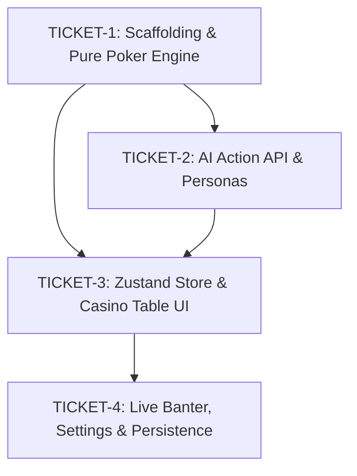

# Ticket Breakdown — AI Poker Challenge

## Epic Summary
An interactive 1v1 Heads-Up No-Limit Texas Hold'em web application where players challenge various AI models (Gemini, Claude, GPT) equipped with distinct playing styles and live banter. Decoupled into a pure functional TypeScript poker engine, a resilient sub-3s AI Action API with fallback handling, a Zustand-driven casino UI, and local session persistence.

---

## Tickets

### TICKET-1 — Project Scaffolding & Pure TypeScript Poker Engine
- **Scope / Acceptance Criteria**:
  - Initialize Next.js 14+ (App Router, TypeScript, Tailwind CSS, Lucide icons, Jest/Vitest for unit testing).
  - Implement core poker types in `types/poker.ts` (`Card`, `Player`, `GameState`, `PlayerAction`, `HandRank`).
  - Implement pure deck module in `lib/poker/deck.ts` (52-card standard deck, Fisher-Yates shuffle, dealing).
  - Implement pure 7-card Texas Hold'em evaluator in `lib/poker/evaluator.ts` (Royal Flush down to High Card with accurate kicker resolution and tie-splitting).
  - Implement pot and betting logic in `lib/poker/pot.ts` (main pot, split pots, all-in detection, blinds posting).
  - Implement functional state reducer in `lib/poker/engine.ts` (`createInitialGameState`, `applyAction`, `advanceStreet`, `resolveShowdown`).
  - Comprehensive unit test suite with 100% coverage on hand evaluation and betting transitions.
- **Per-ticket Context**:
  - [AGENTS.md](file:///c:/Users/ryan_/OneDrive/Desktop/AI%20poker%20challenge/AGENTS.md) (Type Safety, Game Engine Seams).
  - [architecture.md](file:///c:/Users/ryan_/OneDrive/Desktop/AI%20poker%20challenge/architecture.md) (Approach 1.1: Functional Pure Reducer).
- **Files Touched**:
  - `package.json`, `tsconfig.json`, `tailwind.config.ts`
  - `types/poker.ts`
  - `lib/poker/deck.ts`, `lib/poker/evaluator.ts`, `lib/poker/pot.ts`, `lib/poker/engine.ts`
  - `__tests__/poker/evaluator.test.ts`, `__tests__/poker/engine.test.ts`
- **Rough Size**: ~800–1200 lines (including tests).
- **Depends On**: None.

---

### TICKET-2 — Multi-Provider AI Action API & Persona Prompts
- **Scope / Acceptance Criteria**:
  - Implement AI response types and Zod validator in `types/ai.ts` (`action`, `amount`, `thinking`, `chat`).
  - Implement persona definitions and system prompts in `lib/ai/personas/`:
    - `gemini.ts`: Analytical & Calculative.
    - `claude.ts`: Balanced & Strategic.
    - `gpt.ts`: Aggressive & High-Bluffing.
    - `mock.ts`: Fast, deterministic heuristic AI (enabling offline play & testing without API keys).
  - Implement provider clients in `lib/ai/providers/` (`@google/genai`, `@anthropic-ai/sdk`, `openai`) with structured JSON schema parameters.
  - Implement Next.js Route Handler `app/api/poker/ai-action/route.ts`:
    - Sanitizes input game state (ensures human player hole cards are hidden).
    - Enforces 2500ms hard timeout via `AbortController`.
    - Handles client-provided API keys passed via headers or environment variables.
    - Employs defensive fallback: if the model times out, errors, or fails Zod validation, returns a valid heuristic Check/Fold response so gameplay never freezes.
  - Unit/integration tests for prompt formatting, Zod schema validation, and fallback handling.
- **Per-ticket Context**:
  - [architecture.md](file:///c:/Users/ryan_/OneDrive/Desktop/AI%20poker%20challenge/architecture.md) (Approach 2.1: Native SDKs + Zod + Fallback).
  - [ai-poker-challenge.prd.md](file:///c:/Users/ryan_/OneDrive/Desktop/AI%20poker%20challenge/ai-poker-challenge.prd.md) (Section 6 & 7: Turn latency <3.0s, 0 illegal moves).
- **Files Touched**:
  - `types/ai.ts`
  - `lib/ai/personas/index.ts`, `lib/ai/personas/*.ts`
  - `lib/ai/providers/*.ts`
  - `app/api/poker/ai-action/route.ts`
  - `__tests__/ai/route.test.ts`
- **Rough Size**: ~600–900 lines (including tests).
- **Depends On**: TICKET-1 (needs `types/poker.ts` game state types).

---

### TICKET-3 — Zustand Client Store & Casino Table UI
- **Scope / Acceptance Criteria**:
  - Implement Zustand store `store/usePokerStore.ts` managing:
    - Full `GameState` and action dispatchers (`fold`, `check`, `call`, `raise`, `startNewHand`).
    - Turn timer and active AI action request trigger.
    - Hand action history and active round states.
  - Implement Casino-themed components in `components/poker/`:
    - `Table.tsx`: Green felt table oval, pot badge, dealer button, community cards.
    - `CardView.tsx`: SVG/Tailwind playing cards with Framer Motion flip/deal animations.
    - `ChipStack.tsx`: Visual chip denominations and stack badges.
    - `PlayerSeat.tsx`: User and AI avatars, active turn halo indicator, chip count, hole cards.
    - `ActionControls.tsx`: Fold, Check, Call, dynamic Raise slider, quick bet presets (Min, 2.5x, Half-Pot, Pot, All-In).
  - Wire up game loop: Human can complete hands against the Mock AI seamlessly with fluid 60fps animations.
- **Per-ticket Context**:
  - [architecture.md](file:///c:/Users/ryan_/OneDrive/Desktop/AI%20poker%20challenge/architecture.md) (Approach 3.1: Zustand Store).
  - [AGENTS.md](file:///c:/Users/ryan_/OneDrive/Desktop/AI%20poker%20challenge/AGENTS.md) (Dark mode / casino aesthetic).
- **Files Touched**:
  - `store/usePokerStore.ts`
  - `components/poker/Table.tsx`, `components/poker/CardView.tsx`, `components/poker/PlayerSeat.tsx`
  - `components/poker/ActionControls.tsx`, `components/poker/ChipStack.tsx`
  - `app/page.tsx`
- **Rough Size**: ~900–1400 lines.
- **Depends On**: TICKET-1 (poker engine), TICKET-2 (API / mock AI).

---

### TICKET-4 — Live Banter Feed, Settings Modal & Session Persistence
- **Scope / Acceptance Criteria**:
  - Implement `BanterBox.tsx`: Real-time dialogue chat box displaying AI banter, personality badges, and message history.
  - Implement `ThinkingDrawer.tsx`: Collapsible drawer revealing the AI's internal reasoning process based on the user's setting (`live`, `showdown`, `hidden`).
  - Implement `SettingsModal.tsx`:
    - Configure persona selection (Gemini, Claude, GPT, Mock).
    - Input & save user API keys securely in browser `localStorage`.
    - Configure AI thinking visibility (`live` / `showdown` / `hidden`).
    - Sound toggle and table felt customization.
  - Implement session bankroll persistence:
    - Track player chip bankroll across multiple hands.
    - Record win/loss stats against each AI persona.
    - Rebuy/reset bankroll button when a player or AI is busted.
  - Final validation pass: ensure zero illegal state transitions and smooth gameplay.
- **Per-ticket Context**:
  - [architecture.md](file:///c:/Users/ryan_/OneDrive/Desktop/AI%20poker%20challenge/architecture.md) (Approach 4.1: LocalStorage + Session Memory).
  - [ai-poker-challenge.prd.md](file:///c:/Users/ryan_/OneDrive/Desktop/AI%20poker%20challenge/ai-poker-challenge.prd.md) (5+ hands per session metric).
- **Files Touched**:
  - `components/poker/BanterBox.tsx`
  - `components/poker/ThinkingDrawer.tsx`
  - `components/poker/SettingsModal.tsx`
  - `store/usePokerStore.ts` (persistence extension)
  - `types/settings.ts`
- **Rough Size**: ~600–900 lines.
- **Depends On**: TICKET-3.

---

## Dependency Graph

---

## Suggested Execution Waves

1. **Wave 1**: `TICKET-1` — Scaffold project & build 100% test-covered pure poker engine.
2. **Wave 2**: `TICKET-2` — Implement AI persona prompts, multi-provider API route handler, and fallback logic.
3. **Wave 3**: `TICKET-3` — Build Zustand client store, casino table layout, cards, and interactive bet controls.
4. **Wave 4**: `TICKET-4` — Add live banter chat box, AI thinking drawer, settings modal, and local storage bankroll tracking.
